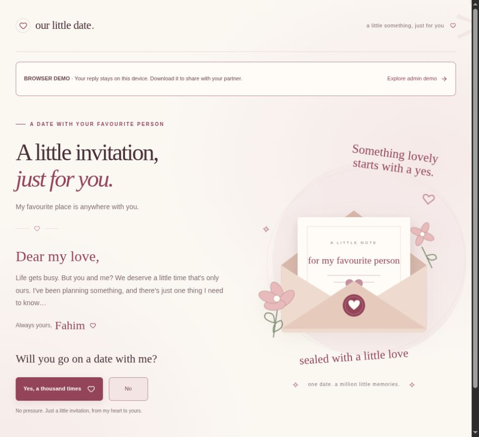

# Our Dream Date

A romantic invitation for a partner: open a private letter, say yes, choose a date and time, pick activities, and leave a personal note. Built for Fahim's gift, with configurable wording that can suit a wife, girlfriend, or other partner.

[Live invitation](https://our-dream-date.vercel.app/) · [Admin demo login](https://our-dream-date.vercel.app/admin/login) · [About](https://our-dream-date.vercel.app/about) · [Public verification report](https://github.com/hamzahossainX/our-dream-date/blob/main/docs/verification/FINAL.md)

Public repository: [hamzahossainX/our-dream-date](https://github.com/hamzahossainX/our-dream-date).

## Status

The Next.js application supports a standalone gift demo and an optional Supabase-backed private invitation. The frontend demo is publicly deployed on Vercel and connected to this GitHub repository. The optional local Supabase environment is implemented; hosted Supabase is not configured for this demonstration.

The standalone recipient demo at `/demo` needs no database credentials. Its final reply stays in that browser's local storage. It does **not** send the reply to Fahim, synchronize across devices, or provide secure shared response management. Use Supabase when Fahim needs to receive and manage real replies from another device.

The admin demo starts empty; the seeded sample replies have been removed. It never signs in to Supabase or opens private responses. Demo setting edits reset on reload; exports and private-link generation require the real dashboard.

## Features

- Responsive English invitation with an animated letter, calendar, time slots, configurable questions, optional note, review, and saved receipt.
- A stationary “Yes, a thousand times” button and playful “No” button that moves away from mouse attempts. Keyboard and touch still support declining; reduced-motion settings remove movement transitions.
- Standalone demo with browser-local final reply storage; clear and try again for testing.
- Optional private invitations store only complete, validated replies in Supabase. Atomic saving and a unique recipient constraint prevent duplicate submissions across devices.
- Authenticated dashboard with statistics, search, filters, response detail, deletion, CSV/Excel export, and versioned invitation customization.
- Public dashboard demo with autofilled sample credentials, clearly separated from real admin access.

## Stack

| Layer | Implementation |
| --- | --- |
| Application | Next.js 16.4 App Router, React 19.3, TypeScript |
| Styling | Native CSS variables, SVG artwork, Lucide icons |
| Data and real admin login | Supabase PostgreSQL, Auth, Row Level Security |
| Exports | CSV and ExcelJS `.xlsx` |
| Verification | ESLint, TypeScript, Vitest, local database/API scenarios, browser review |
| Production target | Vercel connected to GitHub |

Exact versions and scripts are recorded in `package.json` and `package-lock.json`.

## Run the standalone gift/demo

Install Node.js 22.x and npm:

```sh
npm ci
npm run dev
```

Open [the standalone invitation](http://127.0.0.1:3000/demo) or [the admin demo](http://127.0.0.1:3000/admin/demo). No Supabase account, Docker, API key, or real admin login is required for these demo routes. Clearing browser storage removes the recipient's local reply. Admin demo edits reset when the page reloads.

## Enable real private replies locally

Install Node.js 22.x, npm, and a running Docker-compatible container runtime. The Supabase CLI is a project dependency; no global CLI install is needed.

```sh
npm ci
npx supabase start
npm run setup:local
npm run dev
```

Open [the local website](http://127.0.0.1:3000) or [admin login](http://127.0.0.1:3000/admin/login). The helper creates a disposable local admin and a private invitation, writing configuration to ignored `.env.local` and access details to ignored `.local-access.txt`. Open the access file privately. It refuses to replace hosted settings or silently overwrite an existing local setup.

`supabase/config.toml` and migrations are already included. On a fresh local stack, the CLI applies the migrations. For an existing local database, review and apply pending migrations with `npx supabase migration up --local` before provisioning. A local reset deletes local data; it is not an ordinary startup step.

The private invitation's server-saving flow requires the setup above. [The admin demo](http://127.0.0.1:3000/admin/demo) can be shared to demonstrate the dashboard without providing real credentials. Demo completion is explicitly browser-local; only a private invitation's successful server save creates a real dashboard reply.

Use the exact `APP_URL` origin when opening the app. `localhost` and `127.0.0.1` are different origins for session cookies and request validation.

## Configuration and deployment

The names and empty placeholders are in [.env.example](.env.example). Copy it only when following the manual setup; the local helper creates `.env.local` itself. Never commit environment values, access files, passwords, private invitation links, or exported replies.

For a simple demo, import the GitHub repository into Vercel with no database environment variables and share `/demo`. For real private replies, add hosted Supabase for durable storage and authentication. [DEPLOYMENT.md](docs/DEPLOYMENT.md) explains both paths, required accounts, environment variables, migrations, bootstrap, and release checks.

A text or JSON file is suitable for default copy and sample data. Browser storage is sufficient for a personal demonstration on one device. Shared replies need durable storage, concurrent writes, and access control. Vercel's serverless filesystem does not provide persistent local storage, so a response `.txt` file or local SQLite database would lose that guarantee. The optional Supabase integration already supplies those capabilities. [Vercel storage guidance](https://vercel.com/kb/guide/is-sqlite-supported-in-vercel).

## Architecture

```text
app/                    Pages, auth callback, Next.js API routes
components/invitation/  Recipient form, visual states, playful No button
components/admin/       Real dashboard and isolated demo
lib/                    Shared contracts, defaults, validation, exports
lib/server/             Server-only database, auth, sessions, rate limits
supabase/migrations/    Versioned schema, grants, RLS, atomic save functions
supabase/tests/         Rollback-only database security assertions
scripts/                Local setup and invitation bootstrap
tests/                  Validation, behavior, API/database scenarios
docs/                   Design, system model, setup, deployment, evidence
```

Recipient links exchange a bearer token for a signed HttpOnly session. Generated links place the token in a fragment, remove it in the browser, then exchange it through the API. Only a token hash is stored in the database. Treat the original link as private access: anyone who receives it can use it.

Responses keep their submitted wording snapshot, so later question changes do not rewrite history. Drafts stay in browser memory. The standalone demo stores its completed reply only in browser local storage. In private server-backed invitations, deleting a reply retains the recipient's completed marker; generate a new link to accept a new reply.

## Engineering and security rules

- Keep business rules in shared modules and validate all API boundaries server-side.
- Keep elevated Supabase credentials in server-only modules. Verify admin membership or recipient authorization before elevated operations.
- Change the database through reviewed migrations; test grants and RLS as anonymous and unrelated users.
- Publish invitation changes as a new version. Preserve response snapshots and duplicate-submit protection.
- Use semantic color tokens, visible keyboard focus, reduced-motion guards, and responsive controls.
- Check origin/CSRF boundaries, secure session cookies, nonce-based script CSP, persistent rate limits, and spreadsheet formula escaping.
- Use small, reviewable conventional commits. Run applicable checks before merging or deploying. Source changes and database changes need coordinated release review.

Project-specific agent instructions live in [AGENTS.md](AGENTS.md). The installed Genesis/A-Team workflow is documented in [GENESIS_AUDIT.md](docs/GENESIS_AUDIT.md); Claude-only slash commands and hooks are not automatically installed in Codex.

## Verify changes

```sh
npm run lint
npm run typecheck
npm test
npm run build
```

With the local Supabase stack and development app running:

```sh
npm run e2e
```

Integration checks exercise real local authentication, database storage, retry/concurrency behavior, access control, rate limits, filtering, exports, and deletion. Use disposable local data. The rollback-only SQL assertions in `supabase/tests/security.sql` can also be executed with `psql` against the local database after migrations.

Review the invitation and dashboard at phone, tablet, and desktop sizes, including mouse evasion, keyboard decline, reduced motion, invalid links, and a completed test submission. Test the public demo separately and confirm it makes no real admin API calls. [Verification evidence](docs/verification/FINAL.md) records the actual checks and limitations.

## Troubleshooting

| Symptom | Check |
| --- | --- |
| Invitation shows a preview | Supabase variables, signing secret, invitation ID, and bootstrap are configured. Restart development after changing environment values. |
| Login works but access is denied | The Auth user needs membership for the configured invitation; use the setup/bootstrap process. |
| Browser rejects a request | Open the exact `APP_URL` origin; check the configured production URL and cookie settings. |
| Missing tables or functions | Apply the reviewed migrations to the correct database. |
| A reply cannot be submitted again | The link permits one completed reply, including after deletion. Create a fresh test link. |
| Demo edits disappear | Demo data intentionally resets on reload; real persistence requires the authenticated dashboard. |

## Handover

Start with [SETUP.md](docs/SETUP.md), [DEPLOYMENT.md](docs/DEPLOYMENT.md), [STACK.md](docs/STACK.md), and [DATA_MODEL.md](docs/DATA_MODEL.md). The formatted system design is [SYSTEM_DESIGN.docx](docs/SYSTEM_DESIGN.docx). The reference video stays local and is ignored by Git. No public software license has been selected; the owner should choose one before publishing the source for reuse.

## Live preview


